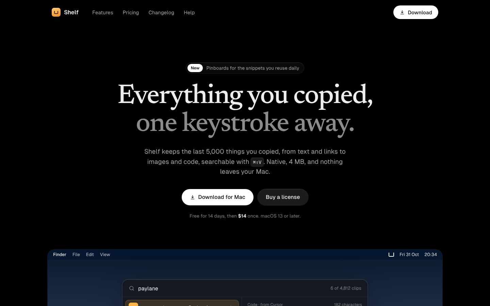
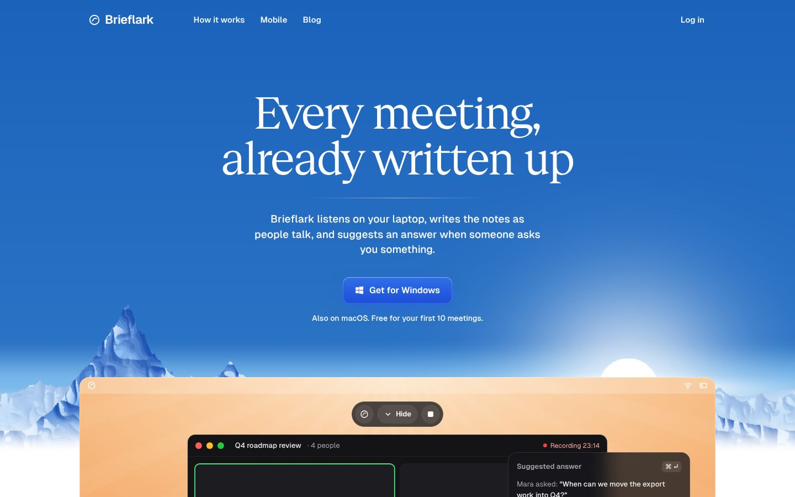
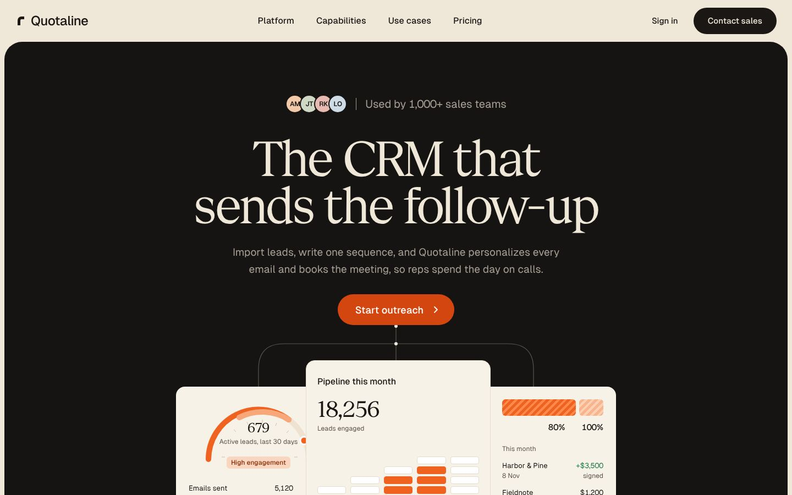
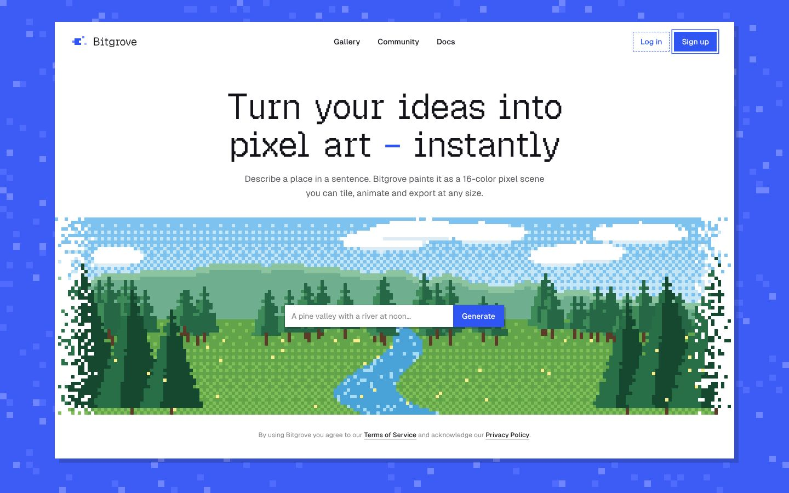
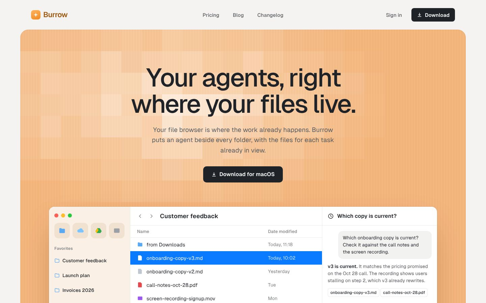
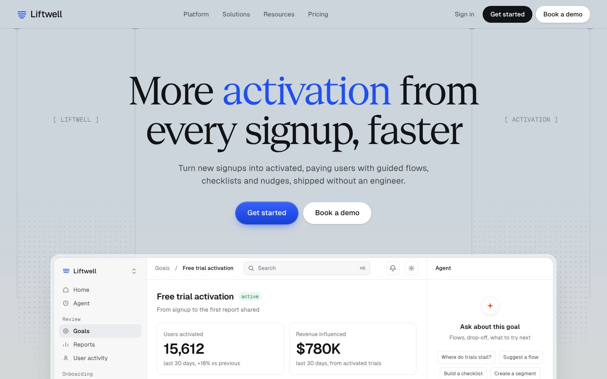
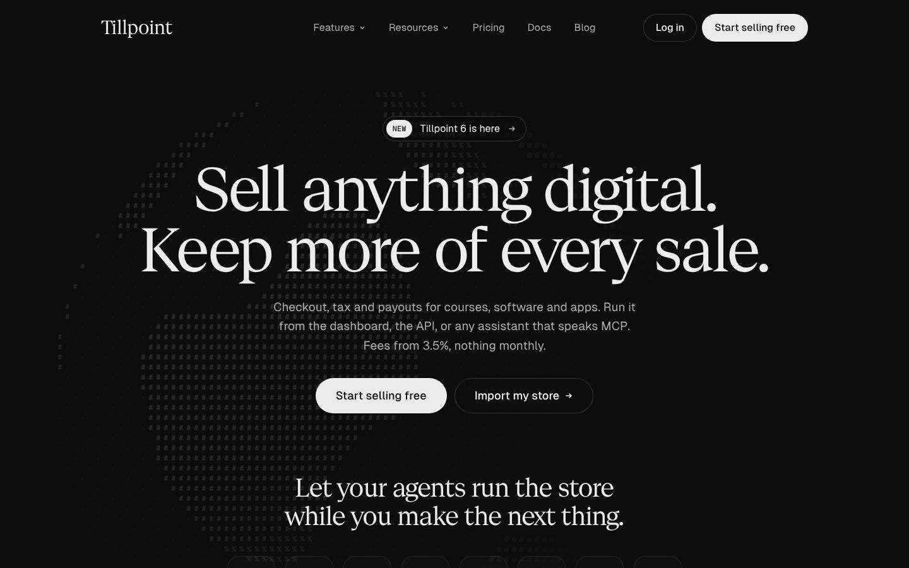
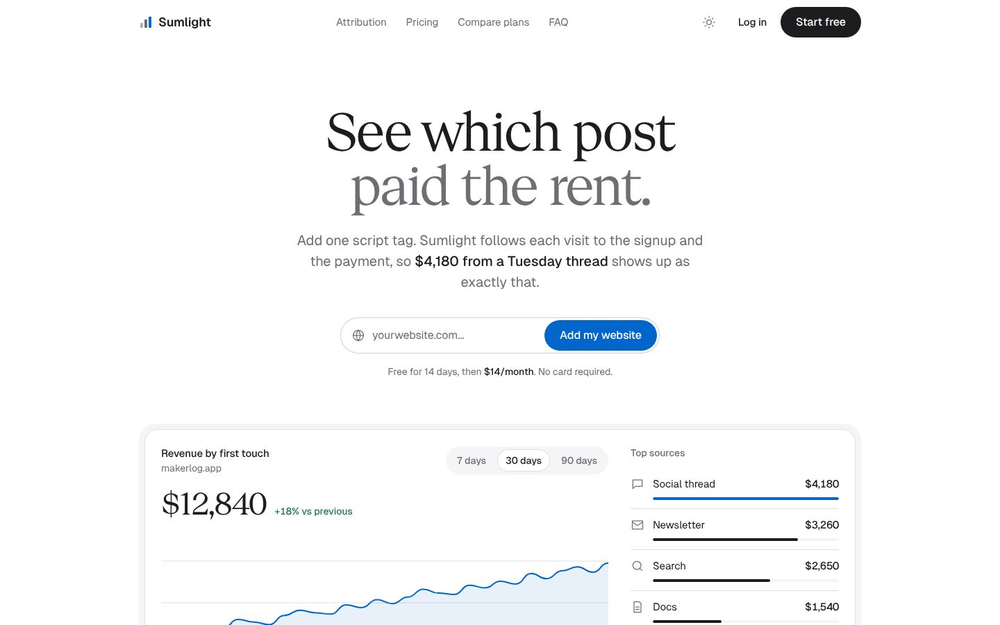

<div align="center">

# majestic-ui

**Ask your AI agent for a website. Get one that looks designed, not generated.**

An agent skill that teaches Claude Code, Codex and other coding agents to build landing pages, app screens and dashboards
that hold up next to the best indie and startup sites, and then checks its own work in a real browser before calling it done.

[](https://aayansharma.netlify.app)
[](https://x.com/aayanships)
[](LICENSE)
[](SKILL.md)
[](examples/README.md)
[](starters/nextjs)
[](scripts)
[](https://github.com/Aayan15728/majestic-ui-skill/stargazers)

<br />

<table>
  <tr>
    <td width="50%"><a href="examples/cinematic-black/"></a></td>
    <td width="50%"><a href="examples/clear-sky/"></a></td>
  </tr>
  <tr>
    <td width="50%"><a href="examples/inset-panel/"></a></td>
    <td width="50%"><a href="examples/pixel-forge/"></a></td>
  </tr>
  <tr>
    <td width="50%"><a href="examples/pixel-panel/"></a></td>
    <td width="50%"><a href="examples/rock-dashboard/"></a></td>
  </tr>
  <tr>
    <td width="50%"><a href="examples/serif-globe/"></a></td>
    <td width="50%"><a href="examples/sections-kit/"></a></td>
  </tr>
</table>

<sub>8 of the 38 reference pages that ship with the skill. Click any one to open its folder.</sub>

</div>

<br />

## The problem

Ask an AI agent for a landing page and you usually get the same page: Inter everywhere, a purple-to-blue gradient,
three feature cards, a drop shadow on every box, and "Supercharge your workflow" as the headline.
It's clean, but it looks generated, and people can tell.

**majestic-ui fixes that by giving the agent three things it doesn't have on its own:**

- **Good taste to copy.** 38 complete, hand-tuned reference pages, so the agent starts from something great instead of from a blank file.
- **Rules that remove the slop.** What to avoid, what to add, and what to keep, with sensible defaults for when you haven't picked a style.
- **A gate it must pass.** A 12-point quality checklist plus scripts that open the page in a real browser and measure it, so "done" means checked, not guessed.

<br />

## Install

The root of this repo **is** the skill, so installing it means putting this folder where your agent looks for skills.

**Claude Code** (one command):

```bash
git clone https://github.com/Aayan15728/majestic-ui-skill ~/.claude/skills/majestic-ui
```

Or with the [skills CLI](https://github.com/vercel-labs/skills):

```bash
npx skills add https://github.com/Aayan15728/majestic-ui-skill
```

<details>
<summary><b>Other agents and project-only installs</b></summary>

<br />

The skill is a plain folder with a `SKILL.md` file, so any agent that supports skills can use it.

| Agent | Personal (all projects) | Project only |
|---|---|---|
| Claude Code | `~/.claude/skills/majestic-ui/` | `<repo>/.claude/skills/majestic-ui/` |
| Codex | `~/.codex/skills/majestic-ui/` | `<repo>/.codex/skills/majestic-ui/` |
| Factory Droid | `~/.factory/skills/majestic-ui/` | `<repo>/.factory/skills/majestic-ui/` |

Windows (PowerShell):

```powershell
git clone https://github.com/Aayan15728/majestic-ui-skill "$HOME\.claude\skills\majestic-ui"
```

For an agent without skill support, point it at `SKILL.md` (or the shorter `SUMMARY.md`) and ask it to follow it.

Restart your agent session so it picks up the new skill.

</details>

<br />

## Use it

You don't need to call it by name. The skill switches on for any UI work. Just ask:

```text
Build a landing page for my habit-tracking app.
```

```text
This dashboard looks AI-generated. Make it look designed.
```

```text
Here's a screenshot. Build it in Next.js and make it work on mobile.
```

```text
Audit the UI in this repo and list the worst problems.
```

```text
Make the pricing section bolder, but keep our brand colors.
```

It works with plain HTML, React, Next.js, Tailwind, shadcn/ui, or whatever stack your project already uses.
**Your own fonts, colors and brand always win** over anything in the skill.

<br />

## How it works

The skill turns "make it look good" into a repeatable process the agent follows step by step.

1. **Read the project first.** The agent looks at your code, colors, fonts and assets before designing anything, so new work fits what you already have. It can write a short `PRODUCT.md` and `DESIGN.md` so later requests stay on-brand.
2. **Pick the work mode.** Building something new is different from polishing or auditing. The mode decides how much the agent is allowed to change (see [Work modes](#work-modes)).
3. **Choose a look from the examples.** It picks the reference page that fits your product and tells you in one line why. For a brand-new product it can offer you two or three directions to choose from.
4. **Look before reading.** It opens the example's desktop and mobile screenshots first, because the screenshots define what "done" looks like.
5. **Copy, don't invent.** It copies the example's real HTML and swaps in your brand, copy, data and fonts, keeping the structure, spacing and small details that make it work.
6. **Write the angle.** Before touching CSS, it writes down the headline idea, the one "signature" detail, and what happens on mobile.
7. **Build, then pass the gate.** It renders the page in a real browser, measures it, fixes what fails (up to three rounds), and runs the slop linter.
8. **Report honestly.** It tells you what was checked, what was a default, and what it couldn't verify. It never marks an unchecked point as passed.

<br />

## Features

### 38 reference pages

Every example in [`examples/`](examples/README.md) is a complete page, not a snippet: 34 landing pages, 3 product screens
(docs, an agent workspace and an analytics dashboard) and a kit of every common lower-page section. Each folder has:

| File | What it's for |
|---|---|
| `index.html` | The full page, ready to copy |
| `web.jpg` / `mobile.jpg` | Screenshots at 1440px and 390px, so the agent knows what "done" looks like |
| `design.md` | Who it's for, how the first screen is composed, the page structure and mobile behavior |
| `style.md` | The exact values: colors, fonts, weights, radii, motion |
| `principles.md` | Why it works, which rules must survive, and how to adapt it |

The [examples index](examples/README.md) maps each look to the kind of product it suits, so the agent picks a
cinematic dark page for a Mac utility and a calm dashboard for analytics, not the other way around.

### Work modes

The agent reads your request and picks a mode. Each mode limits what it may change, so "polish" never turns into a surprise redesign.

| You say | Mode | What it changes |
|---|---|---|
| "build / design a landing page" | **Build** | Everything, inside your brief |
| "redesign", "make it look less AI" | **Redesign** | The visual style, never your product facts or brand assets |
| "polish", "clean up", "tighten" | **Polish** | Details only: spacing, focus, hover, contrast |
| "simplify", "too busy" | **Simplify** | Removes and merges clutter, keeps every feature |
| "review", "audit my UI" | **Audit** | Nothing. Gives you a ranked list of problems |
| a screenshot + "build this" | **Recreate** | Nothing about the design. It matches the image |
| "add a wow moment" | **Showpiece** | One focused interaction you choose from 2–3 ideas |
| "unslop this" | **Unslop** | Fixes AI-looking craft, keeps the product |
| "bolder", "quieter", "animate", "clarify"… | **Refine** | Only the thing you named |
| a dashboard, docs page or tool | **App screen** | Follows product-screen rules for density and every state |

### Smart defaults when you don't pick a style

Most people never say which font or color they want. When you don't, the skill uses tasteful defaults instead of the usual AI look:

- **Fonts:** the Geist family (Geist, Geist Serif, Geist Mono), never Inter by default.
- **Colors:** a calm "Gallery" palette of whites, greys and near-black, with one blue used only for links, the main button and focus rings.
- **Depth:** flat. No drop shadows unless you ask.
- **Avoided by default:** purple, gradient backgrounds, Bricolage Grotesque, and crowded first screens with more than six things competing.

Anything you or your project already decided overrides these.

### Design image to code

Give the agent a screenshot, mockup or Figma export and it switches to **Recreate** mode. It reads the image into
real numbers (layout, sizes, spacing, colors), builds the page in passes, then scores its build against the image
and keeps fixing until the match scores 90 or higher. The result is real HTML, not a screenshot pasted behind the page.

### Fixing AI-looking UI

For an existing screen that looks machine-made, [`references/aiunslopper.md`](references/aiunslopper.md) gives the agent a triage
step, a direction, ten focused passes, and a catalogue of the tell-tale signs to hunt down.

### Audits with a usability score

In **Audit** mode the agent changes nothing. It returns a list of problems ranked by impact, each with the file
and line and the smallest fix:

| Severity | Meaning |
|---|---|
| **P0** | Blocks a task or excludes people (no keyboard access, unreadable contrast, sideways scrolling on phones) |
| **P1** | Hurts most visitors (lost main button, missing loading or error states, fonts not loading) |
| **P2** | Inconsistency or friction (two button styles, broken dark mode, tiny tap targets) |
| **P3** | Polish (alignment, sharper copy) |

It can also score the page against the ten classic usability heuristics, out of 40.

### The quality gate

Before the agent says it's finished, the page has to pass. The **premium floor** is eight things every page needs:

1. Real art in the first screen, not an empty hero
2. One material idea carried through the page
3. A confident headline in two lines
4. Restraint: one accent color, a limited number of things on screen
5. Specific proof, not vague claims
6. Exact details: hairlines, one radius scale, tabular numbers, styled focus
7. Quiet motion
8. Equal care on mobile

Then a **12-point yes/no check** covers atmosphere, headline, copy, your preferences, the product preview,
the signature detail, depth, rhythm, mobile, accessibility, every state (loading, empty, error), and a final
side-by-side comparison with the reference. Any "no" means fix and re-run.

### Accessible interactions

[`references/interactions.md`](references/interactions.md) gives plain-JavaScript, keyboard-correct versions of the widgets landing pages
need: accordions, tabs, switches, calculators, theme toggles, SVG charts, menus and dialogs.

### Light and dark mode

Every token has a light and dark value, `sections-kit` shows every section in both, and the render check can test dark mode with `--dark`.

### Next.js 16 starter

[`starters/nextjs/`](starters/nextjs) is the `sections-kit` example rebuilt as a real Next.js 16 + React 19 app: Geist through
`next/font`, light and dark themes, server components by default with four small client islands,
and an `npm run check:ui` command that runs the skill's checks.

```bash
cd starters/nextjs
npm install
npm run dev
```

<br />

## Scripts

Seven checking tools. They need only **Node 22 or newer** and nothing to install. The browser ones use the
Chrome, Chromium or Edge you already have.

| Script | What it does |
|---|---|
| `slop-lint.mjs` | Scans your HTML and CSS for tell-tale AI-design habits, interface red flags and missing font files. `--defaults` also flags the default avoid list (Inter, shadows, purple, gradients). |
| `verify-render.mjs` | Opens the page in a real browser at 1440px and 390px. Checks contrast over images, that fonts really load, overflow, keyboard focus and widget keys. Writes a side-by-side `compare.png`. |
| `compare-image.mjs` | Renders your page at a design image's size and scores how closely they match, with the regions that differ and why. |
| `extract-spec.mjs` | Reads a design image into numbers: sections, boxes, corner radii, text sizes, colors, plus zoomable tiles. |
| `vendor-fonts.mjs` | Copies a page's fonts next to it (or inlines them) so it looks right wherever the file goes. |
| `score-pages.mjs` | Runs the lint and render check over many pages and prints one ranked table, to compare design options. |
| `inventory.mjs` | Measures design sprawl in an existing codebase (how many colors, sizes, radii, shadows, button styles) and suggests a consolidated set of tokens. |

```bash
node scripts/slop-lint.mjs page.html --defaults
```

```bash
node scripts/verify-render.mjs page.html --ref examples/gallery-tiles --out ./majestic-check
```

`verify-render.mjs` also takes `--dark` (check dark mode), `--app` (dashboards and other product screens) and
`--cdp http://127.0.0.1:9222` (reuse a running Chrome). If no browser is found it exits with code 3 and marks the
visual checks as unverified instead of pretending they passed.

<br />

## What makes the output different

| Typical AI output | With majestic-ui |
|---|---|
| Inter, purple gradient, three cards | A look chosen from 38 real references to fit your product |
| Invented from scratch every time | Copied from a proven page, then adapted |
| Drop shadows on everything | Flat by default, one soft shadow only if wanted |
| "Done!" with no proof | Rendered in a real browser, measured, and compared |
| Looks fine at one width | Checked at desktop and mobile, with full-width buttons and no overflow |
| Missing focus, labels and states | Keyboard, focus, contrast, and loading / empty / error states all checked |
| "Polish" quietly redesigns everything | Work modes limit what may change |

<br />

## What's in this repo

```text
majestic-ui-skill/
├── SKILL.md              the main workflow the agent follows
├── SUMMARY.md            every rule on one page, for short context
├── references/           playbooks the agent opens only when needed
│   ├── modes.md            work modes, audits, usability score
│   ├── direction.md        choosing a look, color strategy
│   ├── default-theme.md    Geist + Gallery defaults, light/dark tokens
│   ├── design-to-code.md   turning an image into code
│   ├── sections.md         pricing, comparison, FAQ, footer…
│   ├── interactions.md     accessible widgets
│   ├── app-ui.md           dashboards and product screens
│   ├── components.md       reusable components
│   ├── interface-rules.md  keyboard, focus, forms, performance
│   ├── aiunslopper.md      fixing AI-looking screens
│   ├── nextjs.md           building in Next.js
│   └── shadcn.md           re-theming shadcn/ui
├── examples/             38 reference pages + shared fonts
├── starters/nextjs/      Next.js 16 starter
└── scripts/              7 zero-install checking tools
```

<br />

## FAQ

<details>
<summary><b>Do I have to tell it which example to use?</b></summary>
<br />
No. The agent picks the example that fits your product and tells you why. You can name one if you have a favorite.
</details>

<details>
<summary><b>Will it override my brand?</b></summary>
<br />
No. Your fonts, colors, logo and existing design system always win. The defaults only apply to things you haven't decided.
</details>

<details>
<summary><b>Which frameworks does it support?</b></summary>
<br />
Any. The examples are plain HTML, and there are guides for Next.js, React with Tailwind, and shadcn/ui. In an existing project it uses your stack.
</details>

<details>
<summary><b>Do the scripts need a browser?</b></summary>
<br />
The lint doesn't. The render checks use an installed Chrome, Chromium or Edge. Without one, they say the visual checks are unverified rather than passing them.
</details>

<details>
<summary><b>Which agents does it work with?</b></summary>
<br />
Any agent that supports the skills format, such as Claude Code, Codex and Factory Droid. The rules are plain Markdown, so you can also point any agent at <code>SKILL.md</code>.
</details>

<details>
<summary><b>Can I use the example pages commercially?</b></summary>
<br />
Not as-is. The code is MIT, but the designs, brand names and logos they're based on belong to their owners. Use them to learn the technique, and use the skill to build your own designs.
</details>

<br />

## License

[MIT](LICENSE) for the skill, references, examples and scripts.

The bundled fonts in [`examples/fonts/`](examples/fonts) (Geist, Geist Mono, Geist Serif, Geist Pixel, Funnel Display,
Newsreader, Instrument Serif and Bricolage Grotesque) use the **SIL Open Font License 1.1**, not MIT. Their license
files are in `examples/fonts/licenses/`; keep them with the fonts if you redistribute them.

## Disclaimer

The example websites are study reconstructions of publicly visible designs, made to show what the skill can do. All product names, logos, and brand designs belong to their respective owners. This project is not affiliated with or endorsed by any of them.

<br />

<div align="center">

### Made by Aayan Sharma

If this skill saved you time, a star on the repo helps a lot.

[](https://aayansharma.netlify.app)
[](https://x.com/aayanships)

<sub>Questions, ideas, or something you built with it? Reach out on <a href="https://x.com/aayanships">X</a>.</sub>

<br />
<br />

<sub>MIT License · Copyright (c) 2026 Aayan Sharma</sub>

</div>
